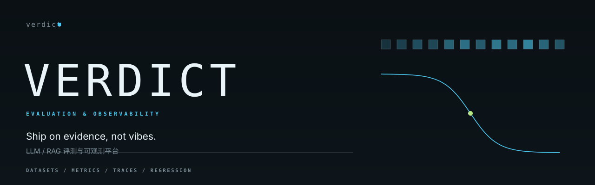

<p align="center">
  <picture>
    <source media="(prefers-color-scheme: dark)" srcset="assets/hero-dark.svg">
    <source media="(prefers-color-scheme: light)" srcset="assets/hero-light.svg">
    
  </picture>
</p>

<p align="center">
  <a href="https://www.python.org/"></a>
  
  
  
</p>

**Ship on evidence, not vibes.**

Verdict is a small evaluation harness for LLM and RAG systems. It separates *what*
you measure from *how* you measure it, so a score can always be traced back to a
metric definition, a case file, and a baseline.

## Why a single number lies

Any one number can be gamed by the wrong mix of cases. Exact match punishes a
correct answer with different punctuation; token F1 rewards overlap that means
nothing; a retrieval score says nothing about the generation that follows it.

Verdict's answer is boring on purpose: report a **dictionary of metrics**, keep the
per-case rows, and compare against a stored baseline with explicit tolerances.

## The metric dictionary

| Metric | Definition | Use it when |
| --- | --- | --- |
| `exact_match` | Normalised string equality | Answers have one canonical form |
| `token_f1` | Token overlap F1 against the reference | Partial credit matters |
| `rouge_l` | Longest-common-subsequence F1 | Summaries and paraphrases |
| `char_bleu4` | Character 4-gram precision with brevity penalty | Short generated text |
| `recall_at_k` | Retrieved docs containing a gold span | Retrieval quality |
| `mrr` | Mean of `1 / rank` of the first relevant result | Ranked retrieval |
| `ndcg_at_k` | Graded relevance discounted by rank | Multiple relevant results |

Every metric is implemented in `metrics.py`, documented with its formula in the
docstring, and covered by a hand-computed unit test. The runner never names a
metric directly: it resolves names through `registry.py`, so adding a metric is
one registration plus one function.

## Running a suite

```console
$ python -m verdict run \
    --cases examples/cases.jsonl \
    --predictions examples/predictions.jsonl \
    --suite demo --out artifacts/run.json
```

The runner emits per-case results and aggregates (mean, median, p95) per metric.
`--json` prints the whole run; without it you get a compact table.

## Baselines and gates

```console
$ python -m verdict compare --baseline baselines/demo-baseline.json \
    --candidate artifacts/run.json --tolerance 0.02
```

A baseline generated from the bundled examples ships in `baselines/`.

Comparison is per metric with an absolute tolerance. The command exits non-zero
when any metric regresses beyond it, which is the only thing you need in CI.

## What the judge is, and is not

`judge.py` defines a `Judge` protocol. The default is a deterministic
`HeuristicJudge` — a rubric-overlap baseline, explicitly labelled as not a model.
`LLMJudge` is an adapter around an injected callable, so wiring a provider never
touches the import path and tests stay offline.

## What measurement costs

`python benchmarks/bench.py --n 2000 --repeat 5`, Apple M5, CPython 3.14.6.
Median of five passes over a synthetic suite; indicative only.

| Operation | Per case | Throughput |
| --- | ---: | ---: |
| `exact_match` | 4.65 µs | 214,939 cases/s |
| `token_f1` | 7.42 µs | 134,702 cases/s |
| `rouge_l` | 17.91 µs | 55,831 cases/s |
| `char_bleu4` | 79.42 µs | 12,592 cases/s |
| `recall_at_5` | 0.85 µs | 1,178,926 cases/s |
| `mrr` | 0.78 µs | 1,282,428 cases/s |
| `ndcg_at_5` | 1.21 µs | 826,603 cases/s |
| full suite (7 metrics + judge) | 135.01 µs | 7,407 cases/s |

## Reports

```bash
python -m verdict report --run artifacts/run.json --out artifacts/report.html
```

Markdown for a pull request, self-contained HTML for a dashboard. Both are plain
files with inline styling; neither loads anything from the network.

## Limits

Jsonl in, jsonl out. No tracing backend, no hosted UI, no statistical significance
testing. Verdict measures; deciding what a difference means is still your job.
